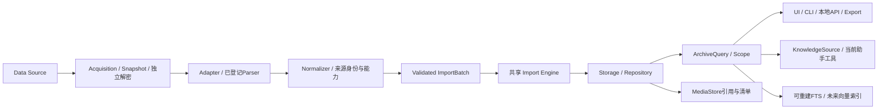

# ChatArchive V2 架构草案

2026-10-14 当前 P2：P2-A/B/C/D 已形成可运行源码闭环：原文引用、独立可重建索引、本地问答 UI，以及 GUI/CLI 复用的 v1.0 stdio 只读 API。最终596项595通过/1原有跳过；新 EXE 的导入导出、工作台、知识撤权/API、独立无登录官方 Codex 四项探测通过。真实本地模型质量与 P1 剩余功能仍待验收/实施。 当前实现/限制及下一步以 [P2-D 版本化只读扩展接口与开发包完成](docs/acceptance/P2_D_API_DESKTOP.md) 和 docs/UPGRADE_CYCLE.md 为准；以下路线中的预留表述保留原方案历史含义。


2026-10-14 当前 P2：增加工具与设置→本地知识问答：范围、离线/本地模型选择、更新/重建索引、原文检索和回查、结构化证据问答、取消、复制及新文件保存。缺证据不调用模型，伪造/缺失引用拒绝，源变化丢弃回答，推断与原文分别标明；既有 Codex 助手保持。默认127.0.0.1:11434无法连接，真实模型质量尚未验收。 当前实现/限制及下一步以 [P2-C 本地证据问答界面完成](docs/acceptance/P2_C_LOCAL_RAG_UI.md) 和 docs/UPGRADE_CYCLE.md 为准；以下路线中的预留表述保留原方案历史含义。


2026-10-14 当前 P2：实现独立 SQLite 向量索引、精确余弦检索、增量复用/删除、显式重建、取消/故障回滚与过期拒查；离线字符向量可直接使用并标为字面检索，Ollama 接口仅选已有本机模型，记录真实模型摘要/维度，不下载或调用云模型。 当前实现/限制及下一步以 [P2-B 独立索引与模型接入完成](docs/acceptance/P2_B_REBUILDABLE_INDEX.md) 和 docs/UPGRADE_CYCLE.md 为准；以下路线中的预留表述保留原方案历史含义。


2026-10-14 当前 P2：实现 KnowledgeSource/ChunkRef，私聊原文按 Unicode 字符切片、稳定 keyset 分页，绑定归档文件身份、身份/联系人范围、消息版本、原文摘要；修改/删除/切库/切范围使引用或游标失效。只读 Schema1/2/3，不创建或迁移用户库。 当前实现/限制及下一步以 [P2-A 引用式知识接口完成](docs/acceptance/P2_A_KNOWLEDGE_SOURCE.md) 和 docs/UPGRADE_CYCLE.md 为准；以下路线中的预留表述保留原方案历史含义。


日期：2026-10-13。**V2指设计迭代，不是当前软件或数据库版本。** 当前应用0.8.0、数据库2、交换1.0均保持。本文为原方案基线：P0-A/B/C已实施身份、领域/能力/引用和显式Schema3副本基础；搜索、真实群聊/媒体产品及知识实现仍待后续，默认Schema2、用户库未迁移，当前有效进度见docs/UPGRADE_CYCLE.md。

## 1. 分层与单一写入边界



Acquisition只负责建立有证据的来源快照/结构化输入；解密通过独立接口实现，Parser不猜测未知字节。Adapter输出统一模型及来源/能力信息，不能直接写SQLite。Importer是导入写入权威；CRUD通过同一存储契约写入。UI、网页、导出、助手只调用范围明确的查询/业务接口。

先保留现有目录与运行入口，按真实需求增加模块：

```text
wechat_archive/
  models/              现有Message保留；新增MessageRecord/SourceRef/MediaRef
  wechat_source/       acquisition、snapshot、固定SDK桥接、独立decryptor接口
  wechat_adapter/      现有base/mock/backup/android/external + 能力描述/兼容包装
  normalization/      来源契约→统一记录；未知类型保留，纯映射
  importer/           现有共享验证/事务/报告 + identity policy / batch session
  database/ migration/ 按版本存储和显式迁移
  services/           ArchiveQuery、Scope、查询与CRUD接口
  media/              相对路径、内容寻址、资源状态、离线清单
  search/             字面查询兼容层、FTS派生索引
  knowledge/          ChunkRef与读取接口；初期无模型/向量库实现
  ui/ web/ agent/     现有入口逐步接服务，保持外部接口
```

这些新增目录只在对应单元有实现需求时创建，避免一次性移动现有全部代码。

## 2. 消息、来源与引用

### MessageRecord建议结构

| 字段 | 类型/含义 | 约束 |
|---|---|---|
| archive_message_id | 本归档稳定ID | 迁移保留旧消息ID；不得以显示位置替代引用 |
| chat_id | 稳定会话ID | 私聊与群聊分开命名空间；群会话不映射为某个接收者 |
| sender_id | 稳定参与者ID，可按system策略为空 | 私聊需合法双方；群发送者按所在分片映射，不能用昵称/固定数字 |
| receiver_id | 私聊接收者；群聊可为空 | 兼容旧字段，在群聊中不是成员列表 |
| timestamp_utc | 规范UTC时间 | 保留来源时间精度/单位；显示时区独立 |
| source_order | 经过登记的原排序/分片顺序 | 同秒事件保持可重复排序；本地ID不默认全球有序 |
| kind | text/image/video/audio/file/location/system | voice仅产品名称，标准audio；未知不改成text |
| original_text | 原文或确认为无文本时为空 | 空格、换行、Unicode不改；text必须非空；生成描述另存 |
| media_refs | 0..N MediaRef | 缺失附件也保留事件；缩略图不能标原件 |
| source_ref | SourceRef及来源原记录引用 | 原始payload可单独存有摘要的私有记录；日志避免复制无关正文 |
| parse_status | accepted/quarantined/unsupported/conflict | 状态与原因可追溯；未知类型不可隐藏 |
| revision | 消息内容/删除版本 | 为索引和引用失效提供条件；不复用已删除ID |

原有 `models.Message`、ExchangeMessage和LoadedDocument是兼容DTO；新领域对象经显式转换进入旧文本路径。设计对象不等于运行已支持相应类型。

### SourceRef与身份政策

SourceRef至少包括provider及版本、source_namespace、owner_account、conversation_external_id、database/shard、id_kind、source_message_id、raw_record_sha256、snapshot_id及原记录位置。账户和分片身份不由昵称/目录散列推断。

逻辑身份由登记的来源契约产生：local ID必须包含所属分片/表的作用域；server ID是否跨分片稳定需通过来源证据核实。保留当前完整复合来源ID和别名映射，不能简单删去shard作为修复。

```text
可信来源键相同 + 内容证据相同 → 同一事件的重复导入
可信来源键相同 + 内容证据不同 → conflict，保存证据，不覆盖
可信来源键不同 + 正文/时间相同 → 两个事件，保留或显式待核对
来源键不可信/缺失              → legacy内容策略并声明局限
```

不能自动恢复此前被合并且没有来源原记录的事件，也不能用同正文推断跨平台事件相同。

MessageRef建议为 `{archive_identity, message_id, revision, source_ref}`。ArchiveScope为归档、owner及可选chat约束；每次查询/引用展开都重新验证。新索引返回ID后仍从权威归档取原文并校验范围/版本，切库撤销旧Scope。

## 3. Adapter能力和流式兼容

保持 `WeChatAdapter.detect(path)`、`load(path)->LoadedDocument`。在其上增加可选 `describe_capabilities()`、`inspect_source()`、`iter_batches(snapshot,cursor,budget)`，通过LegacyAdapterBridge将旧load包装为单批。没有可靠流式能力的旧Adapter继续受原体积限制，不把全文件先加载再切片宣称有界流式。

CapabilitySet独立声明：可识别/可检查/可解析的来源profile、客户端版本、text/group/media、需要明文快照或独立解密、是否提供稳定ID/快照/游标、实测证据。mock永久标为synthetic；rmfh_backup先只声明inspection，不声明正文支持。

新注册器应复用现有 `ADAPTERS` 和选择逻辑，新增能力可由包装器提供，不需要现在将所有目录改成pc_wechat/rmfh_backup/android_backup。未来可以将固定Windows来源显示为pc_wechat能力，但保留external/backup/android CLI标识和旧方法。

ImportBatch含snapshot_id、batch_id、source_cursor、record_count、payload_digest、accepted/retained/issues及末尾游标。来源前置校验、Normalize/Validate和写库结果各自记录，不能把读取完成当成入库完成。

StrictFileImport沿用既有整份原子约定。新StreamingImport必须显示“已提交部分/全部完成”，每批单事务，ImportSession的已提交游标与消息在同一权威库事务提交。中断时重放最后未确认批次，依赖可信来源身份幂等。未验证分页的来源不启用流式模式。

## 4. 存储与迁移决策

### 当前约束

Schema2的精确表清单不允许添加媒体表或FTS附属表；messages只允许text，chats只允许private。旧模型receiver必需，无法表示群消息。只改类型枚举、加表而保持user_version=2都会造成错误兼容声明。

### 推荐目标：显式Schema3，保留旧源库

新应用按Schema版本选择查询/存储实现，可读取旧Schema1/2。实际升级以SQLite backup取得一致性新目标副本，再在副本上事务迁移，禁止覆盖已有目标；原库保留供旧版使用/恢复。迁移后用户明确选新库为唯一工作归档，旧副本不再继续并行写入。

| 建议实体 | 作用 |
|---|---|
| users | 保留旧稳定身份、ID与昵称语义；群成员同样使用稳定身份 |
| chats / chat_members / chat_sources | 扩展private/group与外部会话别名；历史成员信息需要来源支持才保存 |
| messages | 重建允许多类型的约束；保留旧ID、hash及文本；receiver可为空；记录稳定排序和revision |
| message_sources | 来源键/别名与消息映射、raw摘要及身份策略；唯一性按登记策略约束 |
| media / message_media | 内容寻址资源与事件关系、状态、相对路径、校验摘要 |
| import_sessions / import_batches | 一致性快照、已提交批次和断点状态，不把报告文件作为事务权威 |
| archive_metadata / migration_history | 归档身份、Schema版本、内容revision与迁移证据 |

具体DDL应在实现前另审，不能在设计阶段凭空设置所有现有外键删除规则。SQLite表重建、外键、索引和来源唯一性需一并测试；已有legacy重复消息必须保留。

迁移步骤：能力/Schema检查→预估空间→一致性备份与独立完整性验证→新目标副本事务迁移→旧ID/字段/数量与逐条摘要对比→foreign_key_check与integrity_check→各入口读取/导出比对→报告新库路径和恢复方式。故障只清理本操作独占临时目标；原库和旧发行包不动。

**兼容承诺：** 新应用读旧库；旧文本/CLI/交换1.0继续运行；旧数据保留。**不承诺旧0.8程序能打开Schema3。** 若同一文件必须始终被旧程序读取，则保持Schema2且延后富媒体持久化，不采用双库分别写业务消息的捷径。

## 5. chat-exchange版本

保持1.0 Schema文件和运行入口不变。其已预留private/group以及text/image/video/audio/file/system、media_ids，但运行Validator目前仅接受private text和空媒体；location、扩展source字段和新的群接收模型须定义新版本。

新版协议使用显式format_version；新Validator按版本和capabilities协商，不把1.0的additionalProperties=False放宽成任意字段。旧文本可无损导出为1.0；包含新类型的归档如要导出1.0，必须使用明确“仅文本子集”模式并报告省略数，不能静默丢媒体/群事件后标完整导出。

新协议和数据库Schema独立版本化，应用版本也单独管理。原始payload、派生摘要、生成内容不混写original_text。

## 6. 附件生命周期

MediaRef含media_id、kind/mime、sha256、size_bytes、relative_uri、availability以及variant(original/compressed/thumbnail)。MediaStore放于归档明确资源根，采用摘要路径和manifest；外部源路径只作来源记录，不作为跨机器资源链接。

先保存本机已存在且经来源契约确认的资源；自动拉取缺失原件、触发微信UI、外部下载或转码不由归档查询隐式触发。unknown/missing/unsupported仍保留对应消息及理由。

资源操作顺序：独占临时文件→有界复制→类型/尺寸/摘要验证→在资源根内原子落位→SQLite记录关联。文件系统与SQLite不是一个事务，失败需记录pending/ready和可恢复操作；未提交资源以显式回收计划处理，不自动删除疑似共享文件。导出包含已验证资源和缺失清单，保留原件，派生播放格式另记。

## 7. 查询与搜索

ArchiveQuery统一范围、时间、类型、literal keyword、cursor和MessageRef；新版keyset基于稳定 `(timestamp_utc, order, id)`，旧offset入口作为兼容包装保留。联系人摘要先测窗口聚合成本，确需物化时作为可重建派生数据，保持权威原消息。

优先FTS5，保留两个清楚模式：

- 字面子串模式是当前默认语义：1–2字符回退instr；长查询使用经验证的候选索引后再以原文instr过滤，任何能力不足/索引不可信时回退，避免漏项或大小写变化。
- 词语/相关性模式若实现，独立启用并说明与字面不同；中文分词和BM25不默认替代时间升序阅读。

FTS5trigram限制依据[SQLite官方文档](https://www.sqlite.org/fts5.html#the_trigram_tokenizer)，当前运行时的短词差异另有内存探针。

Schema2阶段，FTS存独立派生SQLite，不向原库加表；索引绑定archive_identity、数据内容版本和索引版本。索引不是第二个业务消息库，只能删除重建。已管理写入成功后标脏，统一更新/重建；原库由旧程序或外部进程变更时立即停用索引并回退，防止仅回查命中造成漏掉新消息。

Schema2没有持久内容revision，因此首次/重新打开需基于一致性快照验证内容摘要，不能仅靠路径、mtime或跨连接比较PRAGMA data_version证明一致。data_version只可在同一个长连接内监测其他连接变更；文件身份替换和WAL状态也需检测。查询时固定一致性读快照，在版本一致条件下使用索引；无法保证时整个查询回退原方式。将来Schema3在权威事务维护revision，简化失效策略。

验证实际EXE是否有FTS5/trigram；不得因当前开发Python支持就判发行包支持。规模报告记录硬件、消息长度/分布、范围、冷热缓存、p50/p95、索引体积及更新/重建时间。当前不引入Elasticsearch或自建完整倒排引擎。

## 8. 知识接口与现有助手

保留 `agent` 的既有只读范围和原消息引用。在稳定查询上提供KnowledgeSource：`iter_chunks(scope,cursor,budget)`、`get_chunk(ref)`、`resolve_message(ref)`。ChunkRef包含archive/message/revision、起止字符、UTC、来源；中文字符偏移与UTF-8字节偏移明确分开。

EmbeddingProvider和VectorIndex只定义接口；模型ID/版本、维度、文本处理版本、来源revision必须共同决定索引版本。索引可重建；删改消息、切库和撤权使旧向量结果失效。RAG生成回答需说明证据范围，引用回到原消息；没有来源的推断不得写成聊天事实。

本轮不选择向量数据库、不下载模型、不向模型发送个人聊天。已有Codex实际账号/回答验收继续保留为独立待验证项，离线工具测试不能替代它。

## 9. 实施门槛

先完成 [路线P0-A](UPGRADE_ROADMAP.md) 的来源身份修复；领域模型接旧文本闭环；在自建副本验证迁移；增量获取/索引/附件按单元接入。每个新能力必须贯穿来源→标准化→持久化→查询→展示/导出→回归，只有模型或Schema文件不算产品功能完成。

本设计的事实依据、当前复现和验证边界见 [PROJECT_REVIEW.md](PROJECT_REVIEW.md)。
