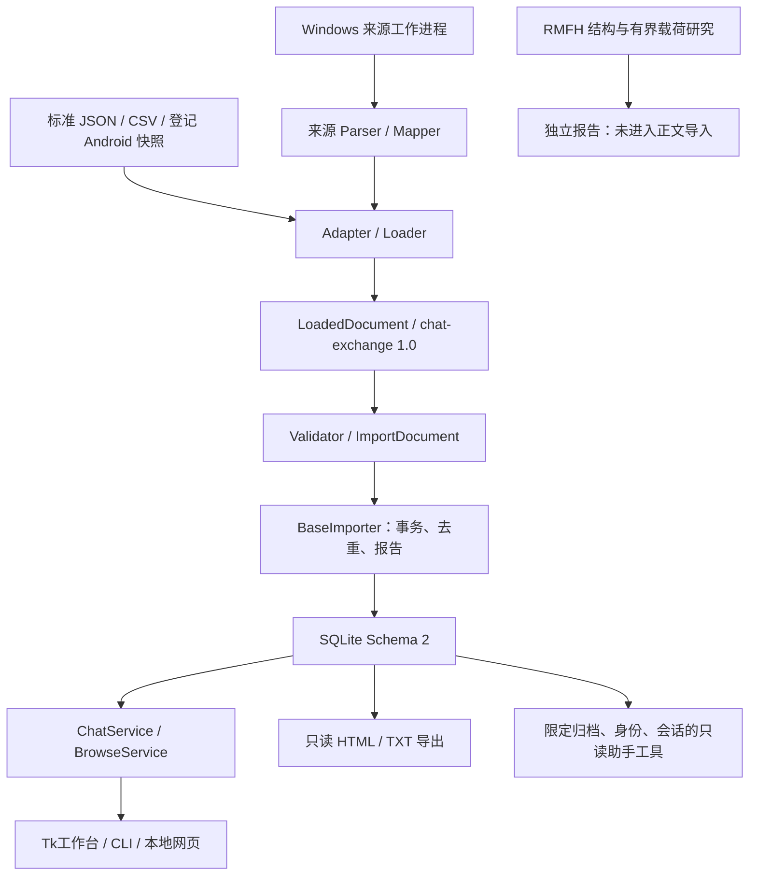

# ChatArchive 项目审查

本文保留2026-10-13的审查基线。当前P0-A/B/C实施与验收进度见[升级记录](docs/UPGRADE_CYCLE.md)，各阶段报告记录已解决问题和仍待验证的能力。

审查日期：2026-10-13（Asia/Shanghai）。软件版本保持 **0.8.0**；数据库 Schema 2；chat-exchange 1.0。本文是项目分析，升级项均为计划，未实施业务改动。

## 1. 结论与审查对象

当前工程已经具备可用的本地文本归档管线、Windows 桌面工作台、真实 Windows 微信结构化来源接入，以及有范围约束的 Codex 助手。升级的首要任务是保证来源身份和历史完整性，随后建立可迁移的消息模型，再扩展搜索、群聊与媒体。保留既有 Adapter、Importer、SQLite 和服务边界，不需要先整体重写。

实际源码位于 `C:\Users\Lenovo\Documents\Codex\2026-10-12\referenced-chatgpt-conversation-this-is-an\outputs\wechat_archive`。审查开始时分支为 `feature/archive-platform-v0-9`，HEAD 为 `ec8c47ab4b30da53cdba09b4055ad58f6a28e27e`，工作区及暂存区干净，没有远程。分支名称不代表软件已发布 v0.9。

当前聊天工作目录是另一个应用文栖，下面也有多个归档源码/打包副本。因此先从实际 Git 仓库复制 **166 个跟踪文件**到独立审查快照，166/166 SHA-256 一致；阅读和自建数据测试均基于这个快照，不使用旧发布目录推断当前能力。未读取个人归档、微信备份正文或账号缓存。

提示文件需要按现状修正的内容：

| 提示文件中的假设 | 当前源码和项目记录 | 升级时的处理 |
|---|---|---|
| 真实微信解析仍是整体缺口 | 已有受限的 Windows 私聊文本接入；Android 仅登记明文快照；RMFH 仅研究 | 按平台、客户端版本、消息类型分别评价，优先完善已有来源 |
| AI 尚未加入 | 已有内嵌 Codex 客户端和只读归档工具；实际账号推理仍待验收 | 保留现有功能，新增向量/RAG仅设计接口 |
| 消息模型扩展可保持 SQLite 结构原样 | 文本/私聊 CHECK 与严格表清单阻止直接扩展 | 第一阶段只设计领域模型；持久化须有明确迁移及兼容承诺 |
| 高星项目可直接作为现成实现参考 | 两个历史高星原仓库已移除代码 | 每个参照重新检查可用性、输入条件、许可证和证据 |

## 2. 当前架构

| 层 | 主要模块 | 现有职责与评价 |
|---|---|---|
| 数据获取 | `wechat_source/acquisition.py`、`live_source.py` | 固定已审查 SDK；工作进程隔离；账号/联系人选择；读取边界与源变化检查。应继续与格式解析分离 |
| 来源契约与标准化 | `wechat_source/parser.py`、`mapper.py` | 检查工具/字段、稳定身份、原始文本证据；保留未支持原记录；输出标准文档 |
| 适配与导入 | `wechat_adapter/base.py`、`importer.py`、`importer/base_importer.py` | 现有 mock/backup/android/external 接口；公共验证与单事务写库。新增适配器应复用此管线 |
| 持久化 | `database/`、`migration/` | 外键、参数化 SQL、备份和迁移；结构验证严格，能保护未知库，但需按版本扩展 |
| 查询与业务 | `services/chat_service.py`、`browse_service.py` | CRUD、字面搜索、分页、计数、联系人最近消息；有明确 UI/数据库分界，但规模成本待测 |
| 展示和导出 | `ui/`、`web/`、`exporter/readable.py`、CLI | 工作台已模块化；旧入口保留；只读一致性导出及新目录保护 |
| 助手 | `agent/client.py`、`tools.py` | 客户端与归档只读工具隔离；有引用、范围和输出预算；当前不是向量检索系统 |
| 交付和维护 | `packaging/`、`tools/`、AGENTS及项目文档 | 固定组件指纹、打包、隐私检查、本地 Git；跨机器验收和依赖再审查仍有待办 |

已有 `Data Source → Adapter → Normalizer → Storage → Service → UI` 的实质分层，只是 Parser/Mapper 与 Importer 中间模型命名未完全统一。建立小范围契约即可，避免引入第二套写库代码。

## 3. 已完成能力与证据等级

“本轮验证”指当前审查实际运行；“历史验收”指已读取的项目验收记录，未在本轮重做真实来源或 EXE 操作。

| 能力 | 状态 | 证据和限制 |
|---|---|---|
| SQLite文本CRUD、私聊、标准导入、事务及旧库迁移 | 已实现；本轮关键回归通过 | 私聊文本，Schema 2；未知库拒绝 |
| 原生工作台、搜索/日期/上下文、分页、原文复制 | 已实现；历史 EXE 验收 | `docs/WORKBENCH_ACCEPTANCE.md`：440项439通过/1权限跳过、EXE分页和导出闭环；150%视觉、系统DPI及跨机器未完成 |
| Windows真实微信获取与导入 | 已实现；历史有限真实验收 | 当前项目记录包含38文本与另一次32文本；这些是不同阶段的验收，不能相加当作完整历史；本轮不重新获取 |
| 全历史获取 | 有界本地来源功能；超限未完成 | 一次合并窗口；超过100000来源项或64MiB拒绝，不保证完整聊天历史 |
| Android | 登记离线明文Schema的私聊文本 | 不支持任意/加密/正在写入数据库；路径检测不等于解析支持 |
| RMFH | 结构、头字段、有界采样及未知编码报告 | 没有经验证的认证解密与正文Schema，未恢复真实正文 |
| 群聊/媒体 | 协议有部分预留；运行及数据库不支持 | Validator与SQL约束同时限制；位置类型尚未在交换1.0枚举中预留 |
| HTML/TXT离线导出 | 已实现；本轮关键回归通过 | 包含全部所选已入库文本，保留原文/时间/方向；导出不会补齐未获取记录 |
| Codex助手 | 已实现；本轮工具/协议自建测试通过 | 项目记录有握手等证据；登录网络问题、实际账号授权与真实回答仍未完成；没有Embedding/向量库 |

## 4. 当前开源参照与差距

以下页面于2026-10-13重新读取。星数仅为GitHub页面的近似快照，不作为兼容性或可用性的证明。

| 项目 | 一手资料可确认的现状 | 适合参照的内容 | 不可外推的内容 |
|---|---|---|---|
| [BlueMatthew/WechatExporter](https://github.com/BlueMatthew/WechatExporter)（约8.5k星） | 保留代码；GPL-2.0；从iTunes备份导出，支持更多类型/群名称、文本和HTML等输出；有增量导出机制 | 附件与群聊展示、增量边界、离线导出及完整性检查 | 不是当前Windows微信库或Android RMFH的即用解析器；README功能不等于本机实测 |
| [sjzar/chatlog](https://github.com/sjzar/chatlog)（约9.2k星） | 原仓库仅保留2025-10-20移除通知，代码/历史已移除 | 来源生态可用性变化这一风险 | 无法基于原仓库审查或接入旧实现；不采用未知镜像补足 |
| [xaoyaoo/PyWxDump](https://github.com/xaoyaoo/PyWxDump)（约9.6k星） | 原仓库仅保留移除通知及相关文件 | 同上，重新核实项目状态 | 不以历史版本宣传证明当前4.x支持 |
| [fanyuantaier/wechatauto-replica](https://github.com/fanyuantaier/wechatauto-replica) | 当前固定来源1.2.6.1；Apache-2.0；README列出读取、媒体等能力，并说明维护时间受限 | 继续核验已选DB接口、分片身份、分页契约和媒体缺失状态 | 上游媒体/完整历史宣传不等于本应用已支持；发送/UI功能不是归档接入所需 |
| [Cjh-y/ChatImportKit](https://github.com/Cjh-y/ChatImportKit) | 小型Swift框架，MIT；说明统一模型、注册器、RMFH外壳；正文解密仍研究中 | 能力声明、统一模型和来源隔离 | 不是高星成熟正文解析器，也不能解决本项目RMFH未知编码 |

本项目的优势是可核验的文本管线、失败隔离、只读来源、旧库保护和多入口回归。主要差距为：完整来源获取、可靠增量身份、附件管理、群聊模型、多版本来源兼容、索引及规模验收。借鉴模型和验收方法，接入前另审许可证与可分发组件，不复制其他项目代码。

## 5. 技术债务与关键风险

### R1 / P0：跨批次去重会折叠不同来源消息

`database/hashing.py:7` 的哈希由内部双方ID、规范时间和正文组成；`importer/base_importer.py:132` 优先用该哈希跳过已存在记录。来源复合ID虽被保存，但未成为通用去重的主键。`wechat_source/mapper.py:59` 能拒绝同一导出内不同来源ID的相同内容，跨导出批次没有对应保障。

本轮复现：用自建Windows来源记录，第一批来源ID A新增1条；第二批来源ID B的发送者/时间/正文相同，返回success、新增0、重复1。两个独立事件被折叠。此为语义问题，不是SHA-256碰撞；不能仅通过加入更多哈希位数解决。

后果：分批、断点、增量导入会放大问题。先建立来源身份规则、兼容旧哈希的冲突政策和跨批次回归，再扩大读取量。没有可靠来源ID时保留legacy内容去重，明确其无法区分的情形。

### R2 / P0：扩展模型和保持旧文件格式存在实际冲突

`database/init.sql` 的 `CHECK(msg_type='text')`、迁移SQL的 `CHECK(kind='private')`、`migration/manager.py:37` 的精确表/列清单共同限制扩展。新增普通表或FTS虚拟表的附属表都会被现有Schema2验证拒绝。本轮在内存Schema2增加一个普通表，复现明确拒绝。

领域模型可以先扩展设计，但不能宣称媒体已经入库。将来推荐显式的新Schema、新应用读取旧库、经备份在新目标副本迁移；旧应用直接打开新库不作兼容承诺。若用户要求旧应用仍能打开同一文件，就必须维持Schema2并限制持久化范围，不能隐式迁移。

### R3 / P0：完整历史和增量契约缺失

`wechat_source/live_source.py:79` 使用有界单次SDK合并窗口，显式停止循环；100000项/64MiB上限有效。现有源码和历史记录已经指出SDK offset窗口问题。放大limit、循环offset或吞掉重复均不能证明无漏项。

需求应改为：一致性快照、可验证的分片排序、稳定游标、批次清单、断点状态及源变更拒绝/重取。验收量是来源事件，不是过滤后的文本数；满足原始数=接受数+隔离数+已确认来源重复数。

### R4 / P1：搜索规模与中文语义

`services/browse_service.py:70` 使用 `instr(content,?)`；每页还做完整计数，联系人列表重新计算窗口排名与计数，分页使用OFFSET。当前已有时间和参与者索引，不能笼统称“没有索引”；问题是没有可加速内容子串匹配的全文索引，以及深分页/聚合的规模成本。

SQLite FTS5适合先做本地原型，但默认词元和trigram不能直接替换原字面子串行为。本轮SQLite3.40.1内存实验：正文“材料计算与微信归档”，搜“微信”：unicode61 MATCH为0、trigram MATCH为0、原instr为1；三字“微信归”在trigram命中1。[SQLite FTS5官方文档](https://www.sqlite.org/fts5.html#the_trigram_tokenizer)说明trigram短于三字符的查询限制。

因此必须保留1–2字字面搜索回退，长查询也验证大小写、标点和子串结果一致性。中文分词属于另一种搜索模式，不能静默改变旧语义。规模延迟仅提出验收目标，本轮没有测百万消息检索。

### R5 / P1：统一只读能力尚未形成稳定内部契约

桌面控制器、导出器、助手等各有只读连接/范围校验实现；引用与范围边界是已有优点，新增媒体和索引时需抽出窄接口，防止一个入口越权或忽略类型。先统一ArchiveQuery/Scope/MessageRef契约，不泛化成插件平台。

### R6 / P1：依赖和交付证据需要扩大

读取组件已固定版本和DB模块指纹，打包使用metadata；上游维护能力有限。应记录完整构建依赖与许可证、SQL/Tk/FTS实际运行能力，在第二台Windows和目标DPI验收。没有检查所有发行目录许可证，不能断言现包缺失某许可证。

### R7 / P1：文档历史与当前计划并存

TODO中保留的旧阶段“未选择账号”“不扩展AI”等条目已经被后续实现/用户需求部分更新；新计划须显式声明当前有效范围，保留历史但避免把旧TODO当作最新缺口。当前文档已有提示语，仍应在下一版本整理能力矩阵与验收索引。

## 6. 搜索方案评价

| 方案 | 本地桌面适配 | 主要成本 | 决策 |
|---|---|---|---|
| SQLite FTS5 | 运行时有支持即可，无单独搜索服务器；属于SQLite内的索引能力 | 分词/子串语义、更新删除同步、重建、容量、实际EXE能力检测 | P1首选原型；Schema2阶段可用独立可重建派生索引，不能直接往原库加表 |
| 自建倒排索引 | 可完全控制词元和匹配 | 一致性、压缩、维护、中文规则及重建都由项目承担 | 不是与FTS5同层的必选替代；仅在FTS5无法满足已测需求时再评估 |
| Elasticsearch | 自托管需要运行并维护独立服务，官方提供容器部署步骤 | 增加服务/资源/升级/备份管理，与当前免安装桌面交付不匹配 | 当前不引入；未来多人/集中检索场景再评估。[官方部署文档](https://www.elastic.co/docs/deploy-manage/deploy/self-managed/install-elasticsearch-with-docker) |

上表中的产品适配结论是根据当前单机部署要求作出的架构判断，不是第三方性能测评。

## 7. 验证记录与适用边界

- 源码核对：实际Git跟踪166文件与独立审查快照逐文件一致；起始工作区干净；实际版本、分支和空远程已核实。
- 本轮关键回归：`test_service.py`、`test_importer.py`、`test_migration.py`、`test_external_source.py`、`test_readable_export.py`、`test_agent.py`，**147运行，147通过，0失败/错误/跳过**，普通本机环境25.615秒。包含原有5万条自建导入案例，本次首次5.417950秒、重复1.652039秒；不能外推媒体/百万条/其他机器性能。
- 初次Windows沙箱测试147项，79通过、4失败、64错误，主要出现导入报告原子改名WinError5；保留日志。在普通本机环境运行同一快照/同一测试集全部通过，没有为通过测试修改产品代码。
- 内存契约探针：Schema2额外表拒绝、image运行能力拒绝、unicode61/trigram短中文子串与instr差异；均为自建数据。
- 独立来源身份复现：两批不同来源ID、同发送者/时间/正文，第二条被当重复；复现当前行为，不是新修复已经完成。
- 历史全量440项及真实EXE/来源证据属于相应验收文档。本轮未重跑全部GUI/网页/打包测试，也未完成真实账号推理、真实来源、其他机器或DPI验收。

本地证据保存在当前工作区 `work/archive_review/evidence/`：`source_manifest.json`、`focused_regression_native.json/.txt`、首次沙箱`focused_regression.json/.txt`、`contract_probes.json`、`identity_probe.json`。这些是独立验证资料，未混入发行包或真实聊天来源。

升级顺序、模块影响及验收门槛见 [UPGRADE_ROADMAP.md](UPGRADE_ROADMAP.md)；建议接口和迁移方案见 [ARCHITECTURE_V2.md](ARCHITECTURE_V2.md)。
