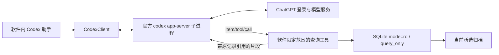

# 软件内 Codex 插件 · v0.7.0

日期：2026-10-13。面向当前个人本地 Windows 归档软件。用户明确选择在软件内登录 ChatGPT、使用 Codex 对话和读取归档。

## 使用方式

1. 完整解压 v0.7.0 软件，双击 ChatArchive.exe。保留 `_internal` 文件夹。
2. 打开已有归档，在“聊天归档”选择查看身份和联系人。
3. 切换“Codex 助手”，点击“连接 Codex”。当前机器会自动找到官方 Codex 桌面版的运行组件；其他机器需要安装 Codex，或通过“选择 codex.exe”选择官方组件。归档软件本身仍不需要另装 Python。
4. 点击“登录 ChatGPT”，在系统浏览器的 OpenAI 官方页面授权。软件不会收集账号密码，登录结果会返回软件。可取消登录或退出登录。
5. 保持“当前会话”，或明确选择“当前身份的所有私聊”。在对话框输入问题并发送；回答流式显示，可停止回答、刷新模型、开启新对话。

例如：“找出我们讨论论文修改的消息，按时间整理待办，每项给出原记录引用。”先在归档页选好该联系人；可让助手继续缩小时间范围或查询关键词。

提问和工具返回的文字会发送给 OpenAI；使用账号当时可用的 Codex 能力与额度。模型目录仅为运行组件返回的目录，不证明某模型已获账号授权。额度、网络、登录和模型错误会明确显示，失败或停止不会显示为回答完成。不会自动发送任何测试问题或聊天数据。

## 接入结构和接口

这是软件自身的嵌入插件模块。登录、会话、流式事件由 app-server 负责；应用数据通过 `dynamicTools` / `item/tool/call` 的客户端响应传回，不配置外部 MCP 服务器。

开发接口：

- `CodexClient.start()`：启动独立 stdio 子进程，先 `initialize`、再 `initialized`，随后 `account/read`。
- `login()` / `cancel_login()` / `logout()`：只使用官方管理的 ChatGPT 登录流程，校验返回 URL 的 HTTPS 与官方域名后由用户浏览器打开。
- `models()`：分页读取模型目录；不在代码里固定某个模型，默认使用运行组件的账号默认模型。
- `send(text, ArchiveScope(path, user_id, peer_id), model=None)`：检查已登录，创建绑定范围的 thread，注册只读工具，调用 `turn/start`。
- `interrupt()`：调用 `turn/interrupt`；成功状态以 `turn/completed.status` 为准。
- `event_sink(event)`：后台事件进入 Tk 主线程队列，显示增量及最终消息。`item/completed` 的正文覆盖可能不完整的流式草稿。
- `new_conversation()` / `close()`：清除工具授权或终止本插件子进程。

消息传输为每行一个 JSON 对象。客户端请求与软件执行的服务端工具请求具有不同 `id`；独立读线程与工具处理线程避免等待工具结果时阻塞协议。未知服务端操作返回明确失败，系统写入及提权请求直接拒绝。

| 应用工具 | 输入 | 结果 |
|---|---|---|
| archive_overview | 无 | 所选范围的消息数、最早和最晚时间 |
| archive_users | limit、offset | 范围涉及的身份、稳定 ID |
| archive_contacts | keyword、limit、offset | 已归档私聊联系人、消息数和最后时间 |
| archive_messages | keyword、peer_id、start_time、end_time、limit、offset | 原消息、双方、UTC/北京时间、引用、分页状态 |
| archive_message | message_id、content_offset、content_limit | 单条原消息或长文本片段，便于核对和继续读取 |

`ArchiveScope` 由界面生成，数据库路径与身份不由模型指定。当前会话只能读双方消息；当前身份模式也不能读其他两人的私聊。关键词 SQL 参数化；时间要求带时区的 ISO 8601，开始包含、结束不包含。每页最多 100 条，偏移最多 1000000；约 48000 字符后缩小返回页，不跳过未返回记录。普通消息正文最多 2000 字符，单条续读最多 8000，并显式给出截断与继续偏移。

结果保留原 UTC 时间、显示时间、消息 ID、来源字段和 `[消息 #ID]`。提示词要求区分原话、归纳与未知；这不保证模型的归纳完全正确，需要按引用核对。原文作为数据返回，不能变成软件操作或新指令。

## 资料与会话边界

运行组件的 `CODEX_HOME` 固定为本软件数据目录下的 `codex_plugin/home`，工作目录为 `codex_plugin/workspace`。官方组件管理本插件的登录缓存；不复制现有 Codex 登录文件，不改共享 `.codex/config.toml`，退出登录只影响此插件。插件自身不写令牌、登录 URL或原文到导入报告/测试凭证。运行诊断 stderr 只排空，不收集日志。

当前对话在进程内保持；使用 ephemeral thread，关闭软件或重连后从新对话开始。本阶段不实现跨启动聊天历史恢复。范围或模型改变会创建新 thread；打开另一归档立即撤回旧工具、关闭旧连接并清空显示。账号登录缓存仍保留在插件自己的目录。

关闭 shell、系统执行、外部应用/插件、Hook、多代理、电脑/浏览器控制、联网搜索与 host skill discovery；thread 采用 read-only 沙箱。应用没有提供写库、原微信获取、微信发送、任意路径或 SQL 工具。归档读取采用只读连接，不初始化或迁移未知库，支持版本 1/2。每次分页是独立只读快照，导入或编辑后应重新查询。

只分析已经入库的私聊文本；群聊、图片、文件、音视频、来源隔离记录和仅在手机上的内容没有因此得到支持。没有改变原数据库 Schema、浏览器、Import Engine 或微信获取契约。

## 验证状态

- 全量回归：414 项，413 通过，1 个已有权限项跳过；31 项新增插件测试使用自建数据与模拟 app-server，包含身份隔离、分页/长文本、只读字节、SQL 注入、独立登录、动态工具回包、流式最终正文、取消、登出、切库撤权和 Tk 按钮流程。
- 本机官方 `codex-cli 0.153.4`：真实 initialize/account/read、动态工具注册、模型目录（6 项）、官方登录开始并立即取消全部通过。未打开测试登录浏览器、未获取用户凭据、未发送真实推理。
- 运行组件实际拒绝旧 `untrusted` 审批策略，已采用 `on-request` 并在客户端拒绝越界的系统操作。生成协议 Schema 与真实握手分别核对；动态工具属于当前官方实验接口。
- 新版 EXE 已在移除 Python PATH/PYTHONHOME/PYTHONPATH 的环境通过：9 页界面，3 条自建数据导入/重复/导出，插件页实际连接官方组件、注册 5 个工具、返回 6 项模型目录、开始并取消登录。没有测试登录浏览器或真实推理。增加发布诊断入口后，7 项桌面测试再次通过。压缩包和原核心/已有库保护见本版本独立凭证。
- 用户实际账号登录、实际额度、联网模型生成与真实归档回答：待用户授权登录后验证，不能以离线测试或模型列表成功替代。

官方依据：[Codex App Server](https://learn.chatgpt.com/docs/app-server?site_variant=chatgpt&translationFallback=pt-BR)。当前个人本地集成采用 app-server 管理登录；如果以后转为商业或托管服务，需按官方 Sign in with ChatGPT 的应用注册路径单独设计。
